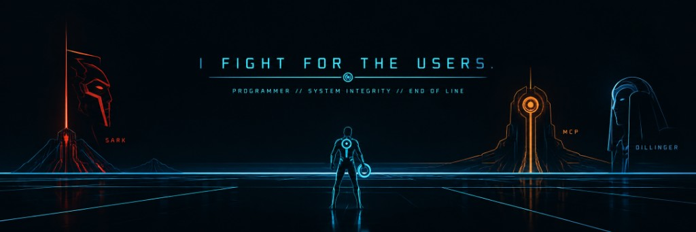

# Kevin Blake Lopez

Full-stack / Product Engineer.

I work at ContinuumGRC on the IT Audit Machine. The work is assessments: evidence collected against controls, examiner review, findings, and reports, for one entity and one audit year.

I build software and work to make it reliable and accountable to the people who use it.

## Stack

TypeScript and PHP. Vue, React, and Adonis.js.

I also work with Express, MongoDB, Mongoose, Flask, SQLite, Angular 15, React 19, React Router 7, Next.js, WordPress, and HTMX.

## Public project

The public project is the [PostgreSQL Persistence Conformance Suite](https://github.com/KevinBlakeLopez/PostgreSQL-Persistence-Conformance-Suite). It arose from my interest in the Adonis.js Lucid ORM, and it is where my PostgreSQL experience comes from. It drives Lucid, MikroORM, and TypeORM through their own APIs, injects controlled failures, and asks PostgreSQL whether the framework's report of the transaction matches what the server did.

## Contact

[kevinblakelopez@gmail.com](mailto:kevinblakelopez@gmail.com)

// END OF LINE
